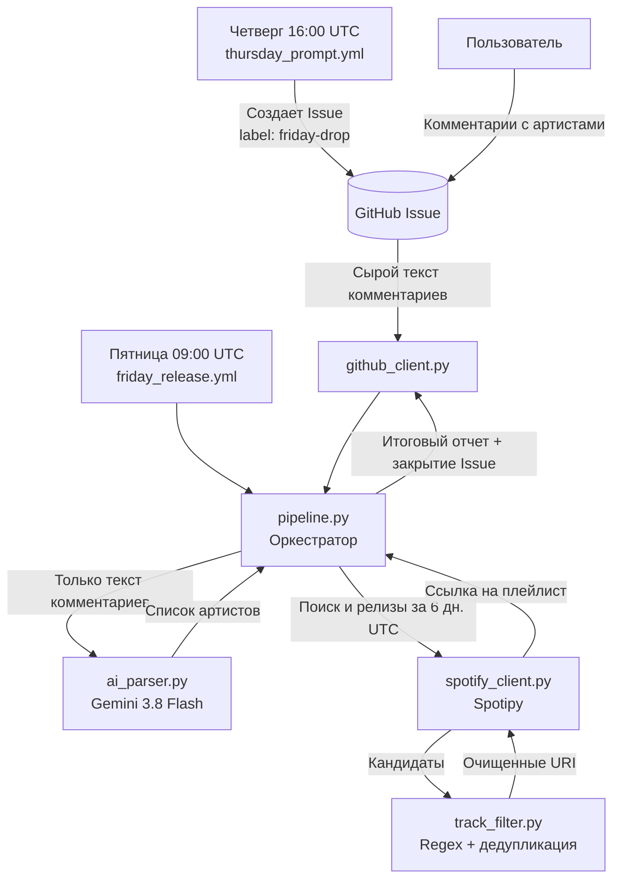

# Friday Drop — ИИ-агент для еженедельных релизов в Spotify

Автоматический ИИ-агент, который каждую пятницу собирает в Spotify плейлист **`Friday Drop — DD.MM.YYYY`** из свежих синглов и альбомов за последние 6 дней (UTC) тех артистов, которых вы указали в четверг в комментариях к GitHub Issue.

## Как это работает

1. **Четверг, 19:00 МСК (16:00 UTC):** GitHub Actions запускает [`thursday_prompt.yml`](.github/workflows/thursday_prompt.yml) и открывает Issue `Пятничный дроп: кого добавляем?` с лейблом `friday-drop`.
2. **Вечер четверга:** Вы пишете в комментариях к Issue имена интересующих артистов в свободной форме.
3. **Пятница, 12:00 МСК (09:00 UTC):** GitHub Actions запускает [`friday_release.yml`](.github/workflows/friday_release.yml):
   - Читает комментарии из открытого Issue.
   - Передает **только текст комментариев** в Gemini (`gemini-3.8-flash` со Structured Outputs) для извлечения чистого списка артистов и исправления опечаток.
   - Находит артистов в Spotify и собирает их релизы за последние 6 дней (UTC).
   - Локально фильтрует треки (убирает `sped up`, `slowed`, `reverb`, `instrumental`, `acapella` и дубликаты).
   - Создает плейлист в вашем аккаунте Spotify, публикует отчет со ссылкой в Issue и закрывает его.
   - Если комментариев с артистами нет, Issue закрывается с пометкой «Артисты не указаны».

> **Соответствие Spotify Developer Terms:** метаданные и названия треков из Spotify не передаются в Gemini API — ИИ используется исключительно для парсинга ваших текстовых комментариев из GitHub Issue.

## Архитектура



## Структура проекта

```text
.
├── .github/workflows/
│   ├── thursday_prompt.yml      # Создание еженедельного Issue по четвергам
│   └── friday_release.yml       # Сборка плейлиста по пятницам
├── scripts/
│   └── get_spotify_token.py     # Однократное получение SPOTIFY_REFRESH_TOKEN
├── src/friday_drop/
│   ├── config.py                # Настройки через pydantic-settings
│   ├── models.py                # Pydantic-модели
│   ├── github_client.py         # Работа с GitHub Issues (PyGithub)
│   ├── ai_parser.py             # Парсинг комментариев через Gemini
│   ├── spotify_client.py        # Работа со Spotify Web API (spotipy)
│   ├── track_filter.py          # Локальный regex-фильтр и дедупликация
│   └── pipeline.py              # Основной пайплайн и CLI friday-drop
├── tests/                       # Unit-тесты (pytest)
├── .env.example
├── .gitignore
└── pyproject.toml
```

## Пошаговая настройка

### 1. Приложение Spotify и `SPOTIFY_REFRESH_TOKEN`

1. Перейдите в [Spotify Developer Dashboard](https://developer.spotify.com/dashboard) и создайте новое приложение.
2. В настройках приложения добавьте Redirect URI:
   ```text
   http://127.0.0.1:8888/callback
   ```
3. Скопируйте **Client ID** и **Client Secret**.
4. Локально установите проект и получите refresh-токен:
   ```bash
   python3 -m venv .venv
   source .venv/bin/activate
   pip install -e ".[dev]"

   cp .env.example .env
   # Укажите SPOTIFY_CLIENT_ID и SPOTIFY_CLIENT_SECRET в .env

   python scripts/get_spotify_token.py
   ```
5. Подтвердите доступ в открывшемся браузере и скопируйте выведенный `SPOTIFY_REFRESH_TOKEN`.

### 2. Ключ Google Gemini API

1. Откройте [Google AI Studio](https://aistudio.google.com/).
2. Создайте API-ключ и сохраните его как `GEMINI_API_KEY`.

### 3. Настройка GitHub Secrets

В вашем репозитории на GitHub откройте **Settings → Secrets and variables → Actions → New repository secret** и добавьте:

| Secret | Описание |
| :--- | :--- |
| `GEMINI_API_KEY` | API-ключ Google Gemini |
| `SPOTIFY_CLIENT_ID` | Client ID приложения Spotify |
| `SPOTIFY_CLIENT_SECRET` | Client Secret приложения Spotify |
| `SPOTIFY_REFRESH_TOKEN` | Refresh-токен, полученный через `scripts/get_spotify_token.py` |

> `GITHUB_TOKEN` и `GITHUB_REPOSITORY` передаются в GitHub Actions автоматически (права `issues: write` уже настроены в workflow-файлах).

## Локальный запуск и тестирование

Запуск пайплайна локально (использует переменные из `.env`):
```bash
friday-drop
```

Запуск тестов и линтера:
```bash
pytest
ruff check .
```
